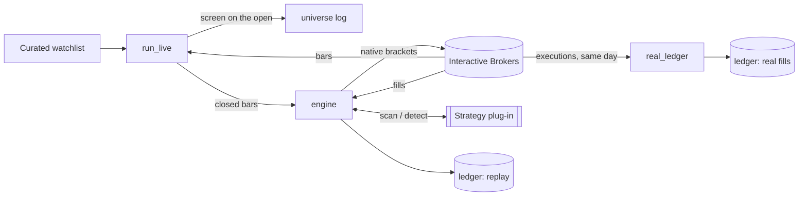

# intraday-trading-harness

[](https://github.com/KevinFuxk/intraday-trading-harness/actions/workflows/tests.yml)

Infrastructure for running intraday strategies against a real broker: pre-armed native brackets,
position state taken from the broker's fills rather than from bars, own-book accounting so several
strategies can share one account, a replay that *is* the live code path, and same-day reconciliation
against the broker's own executions.

I built and operated this harness to forward-test two proprietary intraday chart-pattern strategies
on an Interactive Brokers paper account, running side by side. This
repository is the infrastructure, extracted behind a strategy interface. **The strategies, their
parameters and their results are proprietary and are not included.** A deliberately generic
moving-average cross stands in for them so everything here runs.

## Try it in ten seconds: no broker, no data

```bash
python demo.py        # synthetic sessions through the real engine: arm, fill, exit, EOD, referee
python -m pytest      # the order-state machine, the no-look-ahead contract, reconciliation
```

```
  🛡️ WOULD PRE-ARM 03-03 11:16  ALFA 1min buy-stop $87.87  stop $87.36  tp $88.89 (2R)  245 sh  [ma-cross]
  💥 03-03 11:17  ALFA 1min WOULD FILL entry ≈ $87.87 (trigger $87.87, bar open $87.81)
  🎯 03-03 11:28  ALFA 1min WOULD TAKE PROFIT @ $88.89  (+2.00R, peaked +2.24R)
  SKIP BRAVO 1min setup@142 — stop 0.34% of price < 0.5% floor
  ⛔ FLATTEN (EOD 15:50) — cancelled 0 of my order(s), closing 0 position(s) (0 sh) — own book only
  📋 03-03 11:17  detector confirms entry ALFA 1min $87.87 — pre-armed ✓
  📋 03-03 10:13  detector confirms entry BRAVO 1min $95.99 — NOT pre-armed (occupied / at cap / seeded mid-setup)
  ⚖️  contract OK — 7/7 batch entries reproduced bar-for-bar by the streaming scan over 390 bars
```

## How it fits together



Details, the bracket state machine, and every file the system writes are in
[docs/ARCHITECTURE.md](docs/ARCHITECTURE.md).

## Why it is built this way

Each of these rules was paid for by an incident. All fifteen are written up in
[docs/INCIDENTS.md](docs/INCIDENTS.md), and each code fix has a regression test.

1. **Pre-armed brackets.** A backtest assumes the entry fills at the first touch of the trigger. A
   bot that waits for a bar to close and then sends a market order trades a different strategy from
   the one that was tested. So the native bracket (buy-stop parent, OCA take-profit and stop) rests
   at the broker *while the setup is still forming*.
2. **The broker is the only truth.** A bar crossing the trigger is not a fill: stop orders trigger
   on quotes, not prints. Treating the bar as truth once left a bracket resting as a ghost and let a
   second one arm, which doubled a position ([I-5](docs/INCIDENTS.md#i-5)). Entries are the parent's
   filled quantity; a crossing bar with no fill gets one bar of grace, then a `MISSED FILL`.
3. **Own book.** Every order ref is namespaced by strategy, and the engine acts only on what it
   sent. The account view is read for alarms, never acted on. That is what lets two strategies share
   one account without one selling the other's shares ([I-6](docs/INCIDENTS.md#i-6)).
4. **Two implementations, one truth.** A strategy provides a streaming `scan()` and an independent
   batch `detect()`. The engine referees one against the other live, and
   [`parity.py`](harness/parity.py) proves bar by bar that the stream never looks ahead.
5. **Replay is the live code path.** There is no separate backtest engine to drift away from
   production. Historical bars enter through the same `ingest()` the live stream calls.
6. **Fail flat.** Ctrl-C and every uncaught exception flatten the book before exiting. The flatten
   is idempotent, refuses a second close while one is working, routes on the engine's own contract,
   and is read back before it is believed ([I-1](docs/INCIDENTS.md#i-1), [I-2](docs/INCIDENTS.md#i-2)).
7. **Point-in-time data.** The curated watchlist, every universe verdict, and the broker's executions
   cannot be recreated later, so each is captured on the day.

A few of the incidents, to give a sense of what live trading surfaces that a backtest never will:

| | What happened | Now |
|---|---|---|
| [I-2](docs/INCIDENTS.md#i-2) | A blocking sleep inside an event-loop callback raised, the exception was swallowed, and the flatten re-fired dozens of times, overselling into a short held overnight | EOD flag set first, idempotency window, in-flight guard, `call_later` confirmations |
| [I-3](docs/INCIDENTS.md#i-3) | A partial take-profit under OCA type 1 cancelled the stop for the whole position | OCA type 2, per-ref share counting, a watchdog that restores stop coverage |
| [I-4](docs/INCIDENTS.md#i-4) | OCA children cannot be revised; a "moved" stop never moved | cancel and re-place under a new ref; a fill that beats the cancel kills the successor |
| [I-10](docs/INCIDENTS.md#i-10) | A cleanup tool run twice rested two sells against one position; the open-orders view is client-id scoped | count the account's working closes first, place only the shortfall |

## Layout

| Path | Purpose |
|---|---|
| [`harness/engine.py`](harness/engine.py) | the order engine: bracket lifecycle, broker-truth state, own book, watchdog, flatten |
| [`harness/strategy.py`](harness/strategy.py) | the strategy contract: `Setup`, `Entry`, and the five rules a strategy must meet |
| [`harness/parity.py`](harness/parity.py) | mechanical proof of that contract: streaming vs batch, bar by bar |
| [`harness/bars.py`](harness/bars.py) | the data atom, clock-aligned aggregation, tick-to-bar building, the disk cache |
| [`harness/universe.py`](harness/universe.py) / [`watchlist.py`](harness/watchlist.py) | screening with a permanent record; watchlist discovery, hot-add, archive |
| [`harness/ledger.py`](harness/ledger.py) | one row per trade per variant: replay and real side by side |
| [`run_live.py`](run_live.py) | shadow / armed / replay against Interactive Brokers |
| [`evening_ritual.py`](evening_ritual.py) | after the close: cache, replay, rebuild real fills, report |
| [`real_ledger.py`](real_ledger.py) | trades rebuilt from the broker's executions; anything unexplained is reported |
| [`flatten_leftovers.py`](flatten_leftovers.py) | before the open: close what a previous session left behind |
| [`cache_bars.py`](cache_bars.py) | accumulate the curated universe's intraday history, one session at a time |
| [`splits.py`](splits.py) | develop / validate / lockbox, with the access budget enforced in code |
| [`demo.py`](demo.py) | the engine end to end on synthetic data |
| [`strategies/ma_cross.py`](strategies/ma_cross.py) | the demonstration strategy (no claimed edge) |
| [`docs/`](docs) | architecture, incidents, daily operations, research discipline |

## Running against Interactive Brokers

Requires IB Gateway or TWS in **paper** mode with the API enabled. Live ports are refused.

```bash
pip install -r requirements.txt
python flatten_leftovers.py --execute       # before the open: start flat
python run_live.py --arm --base 25000       # the session (shadow mode without --arm)
python evening_ritual.py                    # after the close, the same evening
```

The full routine and how to read the log are in [docs/OPERATIONS.md](docs/OPERATIONS.md).

## Writing a strategy

```python
from harness.strategy import Setup, Entry, FORMING, ENTERED, DEAD

class MyStrategy:
    name = "mine"                                   # namespaces every order ref it sends

    def scan(self, bars, memo=None):                # streaming: called on every closed bar
        ...                                         # may read bars[:len(bars)] and nothing else
        return {key: Setup(key, FORMING, trigger=t, stop=s, earliest=key + 1)}

    def detect(self, bars):                         # batch, independent: the referee
        return [Entry(bar=i, price=p)]
```

Register it in [`strategies/__init__.py`](strategies/__init__.py), then hold it to the contract
before it ever places an order:

```python
from harness.parity import assert_contract
assert_contract(MyStrategy(), bars)                 # raises on look-ahead, flip-flopping verdicts, bad timing
```

## Research discipline

The harness is half of an evaluation process whose purpose is to make self-deception hard: frozen
evaluation rules, out-of-sample data as a logged budget, null benchmarks built without borrowing the
signal's timing, and replay-versus-real measured every day. See
[docs/RESEARCH_DISCIPLINE.md](docs/RESEARCH_DISCIPLINE.md).

## What is not here

- The two production strategies, their parameters, and anything derived from them.
- Research results, trade ledgers, executions, and account data. `data/`, `cache/` and `logs/` are
  git-ignored.
- Production configuration. Every value in [`harness/config.py`](harness/config.py) is illustrative.

## Requirements

Python 3.10+. The engine, replay, demo and tests use only the standard library.
[`ib_async`](https://github.com/ib-api-reloaded/ib_async) is needed only to talk to Interactive Brokers.
