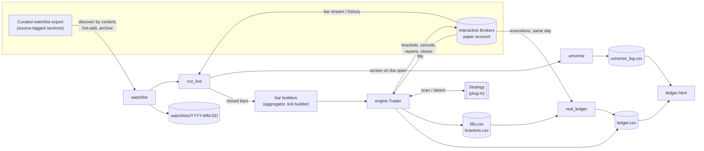
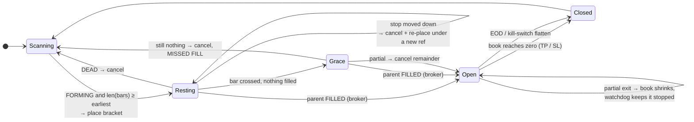

# Architecture

## Components

One `Trader` runs one strategy on one account. Several Traders, in separate processes with separate
client ids, can share an account, because nothing in a Trader acts on anything it did not send
(see *Own book* below).

## The bracket lifecycle

Every transition into `Open` is driven by the broker's fill quantity, never by a bar's high
([I-5](INCIDENTS.md#i-5)). Every transition out of `Resting` cancels the parent; unfilled children
die with it.

## Design decisions

### Pre-armed brackets
A backtest assumes the entry fills at the first touch of the trigger. A bot that waits for a bar to
close above the trigger and *then* sends a market order fills one bar late at a worse price, so the
live system quietly trades a different strategy from the one that was tested. The engine therefore
places the native bracket *while the setup is still forming*: a buy-stop at the trigger plus OCA
exits. The strategy contract guarantees a closed bar exists in which to place it (`earliest > key`).

### The broker is the only truth
Bars describe the market; fills describe the account. The engine never infers a position from a
bar. Entries are the parent's filled quantity, exits are fills against an order ref, and the
end-of-day flatten is read back before it is believed. Where the two disagree, the disagreement is
recorded (`MISSED FILL`, partial entries, fills that beat a cancel) because that gap *is* the
cost model.

### Own book
Every order ref is `<strategy>-<SYM>-<tf>-<date>-k<key>[-r<n>]`. A Trader cancels, repairs, closes and
counts only refs in its own registry, built from its own fills. The account's positions and open
orders are read only to raise alarms. This is what lets two strategies run on one account, and it is
the reason the watchdog sizes stops from the book rather than the account ([I-6](INCIDENTS.md#i-6)).

### Two implementations, one truth
A strategy supplies a streaming `scan()` (what the engine acts on) and an independent batch
`detect()` (what a backtest would book). Live, the engine prints a referee line for every entry the
batch detector finds and says whether the pre-armer caught it. Offline, `harness/parity.py` replays a
session bar by bar and requires every batch entry to be reproduced on the same bar, with no setup ever
changing a final verdict ([strategy.py](../harness/strategy.py) has the full contract).

### Replay is the live code path
`run_live.py --replay` and `demo.py` push historical bars through `Trader.ingest`, which is the same
entry point the live stream calls. There is no separate backtest engine to drift from the live one.
The only differences are where bars come from and that fills are simulated at the level, and that
second difference is measured every evening by putting replay and real fills in one ledger.

### Fail flat
Ctrl-C and every uncaught exception in the main loop flatten the book before the process exits. The
flatten is idempotent within a window, refuses a second close while one is working, routes on the
engine's own qualified contract, and is verified. The watchdog, the hot-add and the broker polling run
on the main thread, never inside stream callbacks ([I-2](INCIDENTS.md#i-2)).

### Point-in-time data
Three inputs cannot be recreated later, so each is captured on the day: the curated watchlist
(archived verbatim, source tags included), the universe verdict for every ticker (written with its
reason), and the broker's executions (served for the current day only). The bar cache accumulates the
universe's own history one session at a time, since it cannot be bought afterwards.

## Time

Every decision is made on a **closed** bar. The final bar of any broker list is skipped on ingest
because, live, it is still forming. Timestamps are exchange time (America/New_York) throughout,
including "is this export from today?", which is why the tests pin the timezone rather than trusting
the machine's.

## Files written

| Path | Writer | Contents |
|---|---|---|
| `logs/<strategy>_<date>.log` | engine | the day's narration: every arm, skip, fill, repair, flatten |
| `data/fills.csv` | engine | every fill with its slippage against the intended level; `MISSED` rows |
| `data/brackets.csv` | engine | every bracket placed or re-placed: ref, trigger, stop, target, qty |
| `data/ledger.csv` | replay, real_ledger | one row per closed trade per variant |
| `data/universe_log.csv` | run_live | every ticker, every day, tradable or the reason it was dropped |
| `data/watchlists/<date>.txt` | run_live | the day's watchlist export, verbatim |
| `data/executions/<date>.csv` | real_ledger | the broker's executions, saved the same day |
| `data/cleanup_log.csv` | flatten_leftovers | every leftover close |
| `cache/bars/<tf>/<SYM>/<date>.json` | cache_bars | one session of bars |
| `data/splits/ACCESS_LOG.txt` | splits | every look at sealed data, with its reason |

None of it is committed: `data/`, `cache/` and `logs/` are git-ignored.
